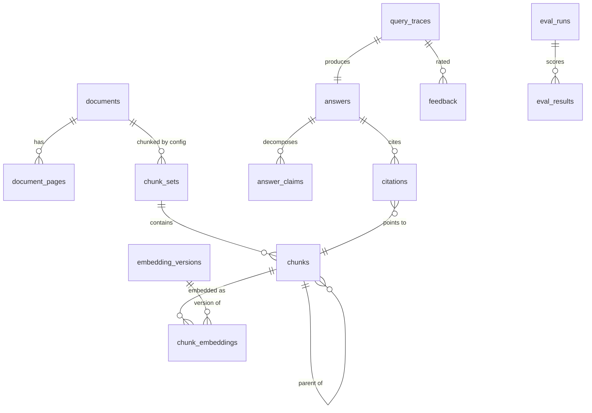

# Architecture

ResearchRAG is a single Python service (FastAPI + a background ingestion worker) backed by one
PostgreSQL 16 database with pgvector. Every pipeline stage is a component behind a small
interface and is selected by a YAML `PipelineConfig`, so evaluation can swap and sweep them.

```mermaid
flowchart LR
  subgraph Ingestion
    U[Upload PDF<br/>API or CLI] --> V[Validate<br/>magic bytes, size]
    V --> Q[(ingestion_jobs<br/>SKIP LOCKED queue)]
    Q --> W[Worker]
    W --> P[Parse in subprocess<br/>RLIMIT_AS + timeout]
    P --> L[Layout: columns, headers/footers,<br/>hyphenation, tables, sections, metadata]
    L --> C[Chunker<br/>fixed / sentence / section / parent-child]
    C --> E[Embedder<br/>batched, cached, rate-limited]
    E --> T{{One transaction}}
    T --> DB[(PostgreSQL + pgvector<br/>documents, pages, chunk_sets, chunks,<br/>chunk_embeddings, HNSW + GIN)]
  end
  subgraph Query
    R[Question + filters<br/>+ conversation] --> CO[Condense follow-up]
    CO --> RW[Rewrite / multi-query]
    RW --> VS[Vector search<br/>HNSW, filters in SQL]
    RW --> LS[Lexical search<br/>tsvector + ts_rank_cd]
    VS --> F[RRF fusion]
    LS --> F
    F --> RR[Rerank]
    RR --> M[MMR]
    M --> X[Small-to-big parents]
    X --> G1[Injection scan<br/>sanitize / flag / drop]
    G1 --> PK[Token-budget packing]
    PK --> GATE{Evidence gate}
    GATE -- weak --> AB[Abstain:<br/>not enough evidence]
    GATE -- ok --> GEN[LLM structured answer<br/>claims + quotes, JSON repair]
    GEN --> CI[Citation + quote checks]
    CI --> VER[Claim verification<br/>lexical / LLM / NLI judge]
    VER --> POL[Policy: remove / flag,<br/>regenerate once]
    POL --> OG[Output guard<br/>canary, payloads]
    OG --> ANS[Answer + citations<br/>+ verdicts + trace id]
  end
  DB --- VS
  DB --- LS
  ANS --> TR[(query_traces, answers,<br/>answer_claims, citations)]
```

## Package layout

| Package | Responsibility |
|---|---|
| `config/` | `Settings` (env, deployment), `PipelineConfig` (YAML, sweepable), pricing table |
| `ingestion/` | PDF parsing (`pdf_parser`), cleaning, sections, metadata, tokenizers, chunkers, isolation, ingestion service, job worker |
| `embeddings/` | `Embedder` protocol; fake, OpenAI, Gemini, local adapters; batching/caching service |
| `storage/` | ORM models, Alembic migrations, `PgDocumentStore`, `PgSearchBackend`, repositories |
| `retrieval/` | candidate types, RRF, MMR, query rewriting, retriever orchestration, in-memory backend |
| `rerank/` | lexical, cross-encoder, LLM rerankers with an LRU cache |
| `generation/` | prompts, JSON repair, answer schema, context packing, generator (incl. stream extraction) |
| `verification/` | citation and quote checks, lexical/LLM/NLI judges, claim verifier and policy |
| `conversation/` | follow-up condensation |
| `security/` | upload validation, prompt-injection scanner and output guard |
| `evaluation/` | dataset, metrics, bootstrap stats, runner, sweeps, gate, calibration, reports, synthetic corpus |
| `observability/` | structlog config + PII redaction, OTel stage recorder, Prometheus metrics, cost metering |
| `api/` | FastAPI app, routers, schemas, problem+json, auth, rate limiting, middleware |
| `llm/` | `LLMClient` protocol, OpenAI(-compatible), Gemini, mock, retry wrapper |
| `pipeline.py`, `factory.py`, `cli.py` | query pipeline, component wiring, Typer CLI |

Provider SDKs (`openai`, `google.genai`) may only be imported by adapter modules; ruff's
`flake8-tidy-imports` rule enforces this.

## Data model

- **Idempotency.** `documents.content_hash` (SHA-256 of the bytes) is unique; chunk ids are
  UUIDv5 of `(content hash, chunking config hash, index)`; embeddings are keyed by
  `(chunk, embedding version)`. Re-ingesting a file is a no-op; a new chunking config adds a chunk
  set from the stored text without re-parsing; a new embedding model adds a version.
- **Indexes.** One partial HNSW expression index per embedding version
  (`(embedding::vector(D)) vector_cosine_ops WHERE version_id = N`), a GIN index on the generated
  `tsvector`, and B-tree indexes on filters (`documents.year`, `collection`, chunk config).
- **Filters inside SQL.** Year range, authors (case-insensitive substring), collection and
  document ids are predicates of the search query itself; references are excluded unless asked.

## Query trace

Every query produces a trace persisted in `query_traces.stages` (JSONB) and emitted as
OpenTelemetry spans: standalone question, rewritten queries, per-method candidates with scores and
ranks, rerank scores, packed context (passage text and pages), the prompt (configurable), raw
model output, generation attempts and repair errors, citation report (dangling/fabricated),
per-claim verdicts (before and after regeneration), guard results, per-stage latency, token usage
and estimated cost. `GET /v1/traces/{id}` returns it.

## Concurrency and deployment model

- The API is async end to end (asyncpg, async SQLAlchemy, async provider SDKs). CPU-heavy PDF
  parsing runs in a separate process; local models run in worker threads.
- Ingestion is asynchronous: uploads return a job id; the worker claims jobs with
  `FOR UPDATE SKIP LOCKED`, heart-beats, retries retryable failures and re-queues jobs whose worker
  died, so several instances can run safely.
- Migrations run under a Postgres advisory lock (`researchrag db migrate` or
  `RR_RUN_MIGRATIONS_ON_STARTUP=true`), so instances starting together do not race.
- Rate limiting is per process (sliding window). For multiple instances, put a shared limiter
  (Redis, API gateway) in front; see the roadmap.
