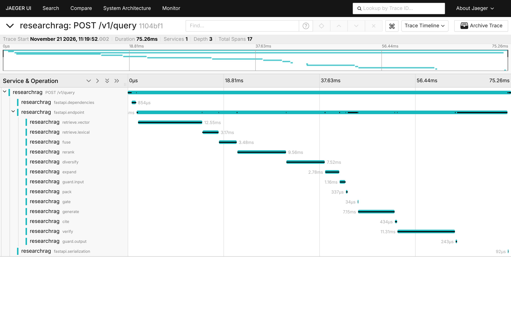

# Observability

Three signals, all correlated by ids:

| Signal | Implementation | Where |
|---|---|---|
| Structured logs | structlog JSON to stdout: `request_id`, `otel_trace_id`, PII/credential redaction, access logs, `query.completed`, `job.*` events | Cloud Logging / `docker compose logs api` |
| Traces | OpenTelemetry SDK, one span per pipeline stage with `rr.*` attributes; OTLP/HTTP exporter | Jaeger (Compose `tracing` profile) or any OTLP backend |
| Metrics | `prometheus_client` at `/metrics` | Prometheus / Grafana / Cloud Monitoring |
| Query traces | every query persisted in `query_traces.stages` (JSONB) | `GET /v1/traces/{id}` |

## Running with Jaeger

```bash
RR_OTEL_EXPORTER_ENDPOINT=http://jaeger:4318/v1/traces docker compose --profile tracing up -d
# ask a question (UI at http://localhost:8000 or curl), then open http://localhost:16686
```

Set `RR_OTEL_CONSOLE=true` to print spans to stdout instead.

## Pipeline spans

| Span | Key attributes |
|---|---|
| `condense` | `rr.history_turns`, `rr.standalone` |
| `rewrite` | `rr.queries` |
| `retrieve.vector` | `rr.count`, `rr.ef_search` |
| `retrieve.lexical` | `rr.count` |
| `fuse` | `rr.lists`, `rr.count` |
| `rerank` | `rr.reranker`, `rr.count` |
| `diversify` | `rr.enabled`, `rr.count` |
| `expand` | `rr.children`, `rr.passages` (small-to-big) |
| `guard.input` | `rr.action`, `rr.flagged` |
| `pack` | `rr.budget`, `rr.count` |
| `gate` | `rr.evidence_score`, `rr.threshold`, `rr.passed` |
| `generate` / `regenerate` | `rr.model`, `rr.attempts`, `rr.repaired`, `rr.failed`, `rr.errors` |
| `cite` | `rr.citations`, `rr.dangling`, `rr.fabricated` |
| `verify` | `rr.judge`, `rr.verdicts`, `rr.faithfulness`, `rr.removed` |
| `guard.output` | `rr.violations` |

## Prometheus metrics

| Metric | Type | Labels |
|---|---|---|
| `researchrag_http_requests_total` | counter | method, route, status |
| `researchrag_http_request_seconds` | histogram | method, route |
| `researchrag_stage_seconds` | histogram | stage |
| `researchrag_tokens_total` | counter | model, kind (input/output) |
| `researchrag_cost_usd_total` | counter | stage |
| `researchrag_queries_total` | counter | outcome (answered/abstained) |
| `researchrag_claim_verdicts_total` | counter | verdict |
| `researchrag_verification_failures_total` | counter | (answers with an unsupported/contradicted claim) |
| `researchrag_injection_flags_total` | counter | kind (input/output) |
| `researchrag_ingestion_jobs_total` | counter | outcome (succeeded/failed/retry) |

Useful derived signals: abstention rate = `queries_total{outcome="abstained"} / queries_total`;
verification failure rate = `verification_failures_total / queries_total{outcome="answered"}`.

## Logs

One JSON object per line. Prompts are never logged unless `RR_LOG_PROMPTS=true`; with
`RR_REDACT_PII=true` (default) e-mail addresses, phone numbers and key-like strings are masked.

Two real lines from the Compose stack (2026-11-21):

```json
{"method": "POST", "route": "/v1/query", "status": 200, "latency_ms": 75.32, "client_key": "3700285e3c8496a5", "event": "http.access", "request_id": "4e60f618ef19487280e39b1bc21aba82", "level": "info", "timestamp": "2026-11-21T11:10:44.662452Z", "otel_trace_id": "f32ba5c963a2f0e12026a38c0076530a"}
{"trace_id": "b898f780-1bcb-4131-be75-9199da9c2e77", "abstained": true, "faithfulness": null, "latency_ms": 104.521, "passages": 6, "cost_usd": 0.0, "event": "query.completed", "request_id": "b679bdcf9163449885f908b08258c22d", "level": "info", "timestamp": "2026-11-21T11:13:29.251770Z", "otel_trace_id": "c4bb11f7d97b73eecc659dce998e10fd"}
```

`client_key` is the SHA-256 prefix of the API key, never the key itself; `otel_trace_id` links a log
line to its Jaeger trace and `request_id` to the `X-Request-ID` response header.

## A real trace

The screenshot and the text capture below were produced by this repository's Compose stack
(`--profile tracing`, offline components) on 2026-11-21.



Text capture of the same trace (Jaeger API; offsets from the request start, then span duration):

```text
traceID 1104bf12b6856162d161983035710c6d 17 spans
    0.00ms    75.26ms  POST /v1/query         {'http.request.method': 'POST', 'http.response.status_code': 200, 'http.route': '/v1/query'}
    0.78ms     0.85ms  fastapi.dependencies   {}
    1.73ms    72.84ms  fastapi.endpoint       {}
    2.01ms    12.55ms  retrieve.vector        {'rr.count': 40, 'rr.ef_search': 64}
   14.66ms     3.17ms  retrieve.lexical       {'rr.count': 36}
   17.93ms     3.48ms  fuse                   {'rr.count': 52, 'rr.lists': 2}
   21.51ms     9.56ms  rerank                 {'rr.count': 24, 'rr.reranker': 'lexical'}
   31.17ms     7.51ms  diversify              {'rr.count': 8, 'rr.enabled': True}
   38.78ms     2.78ms  expand                 {'rr.children': 8, 'rr.passages': 4}
   41.64ms     1.16ms  guard.input            {'rr.action': 'sanitize', 'rr.flagged': '[]'}
   42.85ms     0.34ms  pack                   {'rr.budget': 1800, 'rr.count': 4}
   45.18ms     0.03ms  gate                   {'rr.evidence_score': 1, 'rr.passed': True, 'rr.threshold': 0.34}
   45.26ms     7.15ms  generate               {'rr.attempts': 1, 'rr.errors': '[]', 'rr.failed': False, 'rr.model': 'mock-extractive-v1', 'rr.repaired': False}
   52.48ms     0.43ms  cite                   {'rr.citations': 2, 'rr.dangling': '[]', 'rr.fabricated': '[]'}
   52.95ms    11.31ms  verify                 {'rr.faithfulness': 1, 'rr.judge': 'lexical', 'rr.removed': 0, 'rr.verdicts': '["supported","supported","supported"]'}
   64.41ms     0.24ms  guard.output           {'rr.enabled': True, 'rr.violations': '[]'}
   74.67ms     0.09ms  fastapi.serialization  {}
```

The per-stage durations show where time goes for the offline stack: vector search, reranking and
verification dominate; the mock "LLM" is ~7 ms. An earlier capture of this trace showed MMR
(`diversify`) at ~71-78 ms because similarities were computed pairwise in Python; vectorising it
with NumPy (and computing term sets lazily) brought it to 7.5 ms and the request from ~172 ms to
75 ms. That is the point of per-stage spans.
